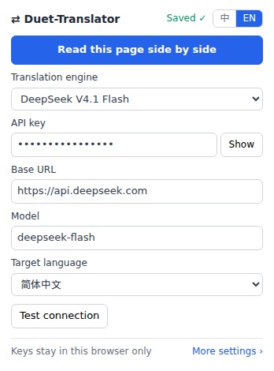

<p align="center"></p>

<h1 align="center">Duet-Translator</h1>

<p align="center"><b>English</b> | <a href="README.zh-CN.md">简体中文</a></p>

Duet-Translator is an Edge / Chrome extension that shows a web page and its translation **side by side**, and keeps the two panes scrolling **in sync, paragraph by paragraph**. You bring the translation engine: a self-hosted LLM (vLLM, SGLang, Ollama…), a hosted API such as DeepSeek, or DeepL.


<sub>Screenshot: the English Wikipedia article "Typography" (CC BY-SA), translated by DeepSeek V4.1 Flash. The highlighted paragraph is the same one on both sides.</sub>

## Features

- **The real page, twice.** Both panes load the actual page, so layout, images, links and login state stay intact. Only the right pane is translated, in place.
- **Paragraph-aligned scrolling.** Scroll either side and the other follows; the paragraph you are reading lines up on both sides, and both reach the top and bottom together, even when the translation is much longer or shorter than the original.
- **Pay only for what you read.** Only the visible area (plus half a screen) is translated. Nothing is requested while you scroll, requests you scrolled away from are cancelled, and translations are cached locally.
- **Formatting preserved.** Links, bold/italic, inline code, citation markers and images survive translation; code blocks are left untouched.
- **Bring your own engine.** Any OpenAI-compatible endpoint (vLLM, SGLang, Ollama, LM Studio, llama.cpp, DeepSeek, OpenRouter, Qwen/DashScope…) or DeepL.
- **Hover to compare.** Hovering a paragraph highlights its counterpart on the other side.
- **Chinese / English interface**, switchable at any time.

## Install

Duet-Translator is not on the extension stores yet; load it from source:

1. Download or clone this repository.
2. Open `edge://extensions` (or `chrome://extensions`) and turn on **Developer mode**.
3. Click **Load unpacked** (not "Pack extension") and select the **`extension/`** folder — the one that directly contains `manifest.json`.
4. Pin the Duet-Translator icon from the extensions (puzzle-piece) menu.

After pulling new code, click **Reload** on the extension card and refresh the page.

> Edge derives the ID of an unpacked extension from its folder path. If you move the folder, Edge treats it as a new extension and you will need to enter your API key again.

## Set up an engine



Click the Duet-Translator icon in the toolbar:

1. Choose a **translation engine** (DeepSeek V4.1 Flash by default).
2. Paste your **API key**, and change the base URL or model if needed. Changes are saved automatically.
3. Click **Test connection**.
4. Click **Read this page side by side**.

Changes apply immediately to a page that is already open: after you enter a key, failed paragraphs are retried; after switching engine or target language, the right pane is re-translated.

Batch size, concurrency, extra request parameters, a custom prompt and additional engines live under **More settings**.

<br clear="right">

### Engine presets

| Engine | What to fill in |
|---|---|
| DeepSeek V4.1 Flash | API key only. Base URL `https://api.deepseek.com`, model `deepseek-flash`, with `{"thinking": {"type": "disabled"}}` preset |
| Self-hosted LLM (OpenAI-compatible) | Base URL up to `/v1`, e.g. `http://127.0.0.1:8000/v1`, and the model name served by your server. Key is optional |
| DeepL | Endpoint (`https://api-free.deepl.com` for the free plan) and auth key |
| Mock | Offline demo, calls no API |

Useful **extra request body** values (More settings → engine):

- DeepSeek V4.1 Flash: `{"thinking": {"type": "disabled"}}` — translation does not need reasoning. In our tests this cut the latency of one paragraph from 5.1 s to 1.9 s and output tokens from 411 to 68.
- Qwen3 on vLLM / SGLang: `{"chat_template_kwargs": {"enable_thinking": false}}`

If your model runs on a remote GPU box, just make its address reachable from the browser, e.g. `ssh -L 8000:localhost:8000 gpu-host` and use `http://127.0.0.1:8000/v1`.

## Usage

| Action | |
|---|---|
| Toolbar icon | Open the popup: start/stop, engine, key, language |
| `Alt+Shift+Y` (`⌥⇧Y` on macOS) | Start / stop Duet-Translator on the current tab (change it at `edge://extensions/shortcuts`) |
| Right-click → *Duet-Translator: read side by side from here* | Start at the paragraph you clicked |
| Top bar | Target language, engine, sync on/off, hover highlight, **Whole page**, swap sides, settings, close |
| Divider | Drag to resize the panes |
| Close | The original page returns to the paragraph you were reading |

## Controlling cost

- Only the visible area plus 0.5 screen below is translated (*More settings → screens to pre-translate*; `0` = visible area only).
- No requests while scrolling. Translation starts about 0.3 s after you stop, so content you fly past is never sent.
- In-flight requests for paragraphs you have scrolled far away from are cancelled, so the server stops generating.
- Hidden menus, text already in the target language, and cached paragraphs are never sent.
- **Whole page** asks for confirmation first and tells you how many characters it will send.
- The top bar shows how many characters this page has sent so far.

On the Wikipedia article above, four stops one screen apart sent about 12,000 characters in total, against about 46,600 for the whole visible article. With DeepSeek (reasoning off) the current screen was fully translated 2–5.5 s after each stop.

## Privacy

- API keys are stored only in this browser (`chrome.storage.local`, not synced) and are used only by the extension's background worker, never exposed to web pages.
- Page text is sent only to the engine you configure.
- To split pages that forbid being embedded, Duet-Translator temporarily removes `X-Frame-Options` / CSP response headers **for the frames of that one tab** while it is open. You can turn this off in settings (such sites then cannot be split).

## How it works

The current tab is covered by a full-screen layer that holds two same-origin iframes of the same URL, so cookies and `X-Frame-Options: SAMEORIGIN` just work. Both panes split the page into paragraphs with the same algorithm and key each paragraph by a hash of its source text, which gives matching anchors on both sides. The longest increasing subsequence of those anchor pairs yields a monotonic, piecewise-linear mapping between the two scroll positions, and a "sliding focus line" makes both sides align at the paragraph being read while still reaching the top and bottom together.

The full design (architecture, sync algorithm, translation pipeline, scheduling) is in [docs/DESIGN.md](docs/DESIGN.md) (in Chinese).

## Development

No build step: the extension is plain JavaScript (Manifest V3).

```bash
cd test
npm install
npx playwright install chromium   # add --with-deps on a fresh Linux box
npm run test:unit                 # scroll-sync math (node:test)
npm run test:options              # settings page and popup
npm run test:e2e                  # loads the extension in Chromium and checks alignment, translation, cost control
npm run demo                      # local demo page at http://127.0.0.1:8787/article.html
```

Live smoke test against a real engine (the key is read from the environment only):

```bash
LIVE_BASE_URL=https://api.deepseek.com LIVE_MODEL=deepseek-flash LIVE_API_KEY=sk-... \
LIVE_EXTRA='{"thinking":{"type":"disabled"}}' LIVE_URL=https://en.wikipedia.org/wiki/Typography \
node e2e/live.mjs
```

Adding an engine: implement `translate(segments, cfg, ctx) → Promise<string[]>` in `extension/background/providers.js` and declare its form fields in `extension/options/options.js`.

## Known limitations

- Each page is loaded twice (once per pane); ads or randomized content may differ between the two sides.
- Text inside Shadow DOM (web components) is not translated.
- Browser pages (`edge://`), the extension stores and the built-in PDF viewer cannot be split.
- Translations appear one batch at a time; streaming is on the roadmap.

## License

[MIT](LICENSE) © 2026 SuperFCR
