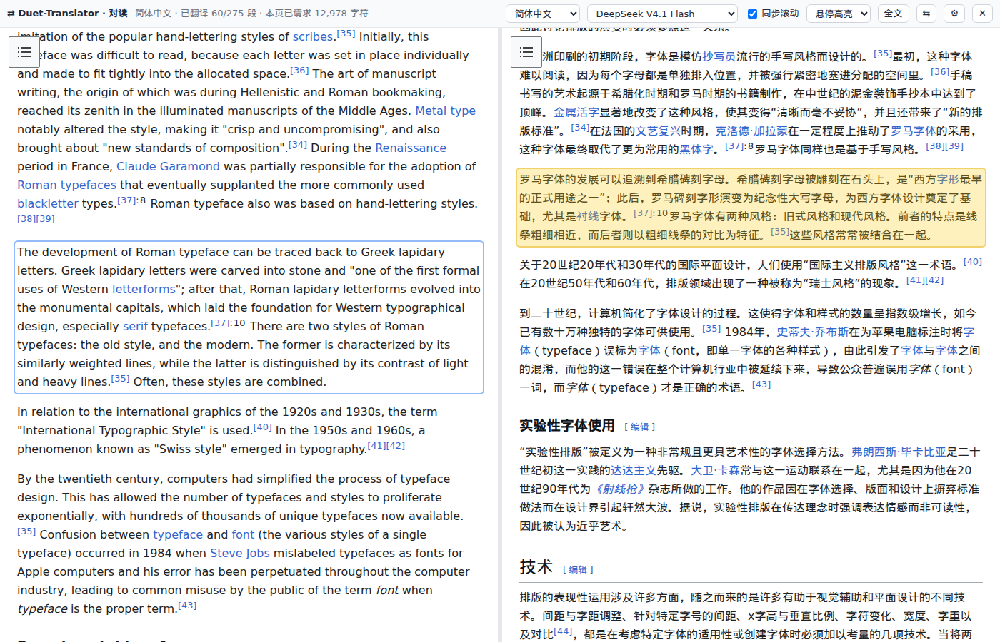
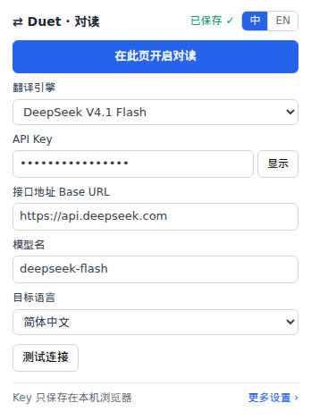

# Duet · 对读

[English](README.md) | **简体中文**

Duet 是一个 Edge / Chrome 扩展：左边原网页，右边译文网页，**按段落对齐、同步滚动**。翻译引擎由你决定：自部署大模型（vLLM、SGLang、Ollama…）、DeepSeek 等在线 API，或 DeepL。



<sub>截图：英文维基百科 "Typography" 条目（CC BY-SA），由 DeepSeek V4.1 Flash 翻译；高亮的是左右对应的同一段落。</sub>

## 特点

- **两边都是真实网页**：左右两个窗格加载的都是原网页本身，排版、图片、链接、登录状态都在；只有右侧被原地翻译。
- **按段落对齐的同步滚动**：滚任意一侧，另一侧跟随；正在读的那一段两侧对齐，并且同时到顶、同时到底。即使译文比原文长很多或短很多也一样。
- **读到哪翻到哪，按需付费**：只翻可视区域（加半屏余量）；滚动中不发请求；已划走的在途请求会被取消；译文本地缓存。
- **保留格式**：链接、粗体/斜体、行内代码、引用角标、图片都保留；代码块不翻译。
- **引擎自选**：任何 OpenAI 兼容接口（vLLM、SGLang、Ollama、LM Studio、llama.cpp、DeepSeek、OpenRouter、通义 DashScope…）或 DeepL。
- **悬停对照**：鼠标停在一段上，另一侧对应段落同时高亮。
- **中 / 英文界面**随时切换。

## 安装

暂未上架扩展商店，从源码加载：

1. 下载或 clone 本仓库。
2. 打开 `edge://extensions`（Chrome 为 `chrome://extensions`），打开 **开发人员模式**。
3. 点 **加载解压缩的扩展**（**不是**"打包扩展"），选择 **`extension/`** 文件夹，也就是直接包含 `manifest.json` 的那一层。
4. 在工具栏的"扩展"（拼图图标）菜单里把 Duet 固定到工具栏。

更新代码后，在扩展卡片上点 **重新加载**，再刷新网页。

> Edge 按文件夹路径给"解压缩的扩展"分配 ID。移动或重命名文件夹后会被当成新扩展，API Key 需要重新填写。

## 设置引擎



点工具栏上的 Duet 图标：

1. 选择 **翻译引擎**（默认 DeepSeek V4.1 Flash）；
2. 粘贴 **API Key**，需要的话修改接口地址、模型名。修改自动保存；
3. 点 **测试连接**；
4. 点 **在此页开启对读**。

已经打开的页面会立即使用新设置：填好 Key 会自动重试失败的段落；切换引擎或目标语言会重新翻译右侧。

批量大小、并发、额外请求参数、自定义 prompt、新增引擎等在 **更多设置** 里。

<br clear="right">

### 引擎预设

| 引擎 | 需要填写 |
|---|---|
| DeepSeek V4.1 Flash | 只需 API Key。接口地址 `https://api.deepseek.com`，模型 `deepseek-flash`，已预置 `{"thinking": {"type": "disabled"}}` |
| 自部署 LLM（OpenAI 兼容） | 接口地址到 `/v1` 为止，例如 `http://127.0.0.1:8000/v1`；模型名填服务端的模型名；Key 可空 |
| DeepL | Endpoint（免费版为 `https://api-free.deepl.com`）和 Auth Key |
| Mock | 离线演示，不调用任何 API |

常用的 **额外请求体**（更多设置 → 对应引擎）：

- DeepSeek V4.1 Flash：`{"thinking": {"type": "disabled"}}`。翻译不需要推理，实测单段延迟从 5.1 秒降到 1.9 秒，输出 token 从 411 降到 68。
- vLLM / SGLang 上的 Qwen3：`{"chat_template_kwargs": {"enable_thinking": false}}`

模型部署在远程 GPU 机器上时，只要浏览器能访问到它的地址即可，例如 `ssh -L 8000:localhost:8000 gpu-host`，接口地址填 `http://127.0.0.1:8000/v1`。

## 使用

| 操作 | |
|---|---|
| 工具栏图标 | 打开弹窗：开关对读、引擎、Key、语言 |
| `Alt+Shift+Y`（macOS 为 `⌥⇧Y`） | 在当前标签页开 / 关对读（可在 `edge://extensions/shortcuts` 修改） |
| 网页右键 →「对读：从这里开始」 | 从右键处的段落开始 |
| 顶栏 | 目标语言、引擎、同步开关、悬停高亮、**全文**、交换左右、设置、关闭 |
| 分隔条 | 拖动调整左右宽度 |
| 关闭 | 原页面回到你正在读的那一段 |

## 控制费用

- 只翻可视区域及下方 0.5 屏（更多设置 →「视口下方预翻译屏数」，设 `0` 只翻可见区）。
- 滚动中不发请求；停下约 0.3 秒后才翻译当前位置，快速划过的内容不会被发送。
- 已经划远的段落，其在途请求会被取消，服务端停止生成。
- 隐藏菜单、已是目标语言的文字、已缓存的段落都不会发送。
- **全文** 按钮会先弹框告诉你将发送多少字符。
- 顶栏实时显示本页已请求的字符数。

以上图维基百科条目为例：停 4 次、每次下滑约一屏，共请求约 1.2 万字符；整篇可见文字约 4.66 万字符。使用 DeepSeek（关闭推理），每次停下后 2–5.5 秒当前屏翻完。

## 隐私

- API Key 只保存在本机浏览器（`chrome.storage.local`，不同步到云端），只在扩展后台使用，不会进入网页。
- 网页文字只会发送给你配置的翻译引擎。
- 为了让禁止嵌入的网站也能分屏，对读期间会**仅对该标签页的子框架**临时移除 `X-Frame-Options` / CSP 响应头。可在设置中关闭（关闭后这类网站无法分屏）。

## 原理

在当前标签页上盖一层全屏界面，里面放两个与原页面同源、加载同一 URL 的 iframe，因此 cookie 和 `X-Frame-Options: SAMEORIGIN` 都天然可用。两个窗格用同一算法切分段落，并以原文哈希作为段落 key，得到两侧一一对应的锚点；对锚点对取最长递增子序列，得到单调的分段线性映射；再用随滚动进度移动的"焦点线"，让正在读的段落两侧对齐，同时保证两侧同时到顶、到底。

完整设计（架构、同步算法、翻译管线、调度）见 [docs/DESIGN.md](docs/DESIGN.md)。

## 开发

无构建步骤，扩展是纯 JavaScript（Manifest V3）。

```bash
cd test
npm install
npx playwright install chromium   # 全新 Linux 环境加 --with-deps
npm run test:unit                 # 同步算法单测（node:test）
npm run test:options              # 设置页与弹窗
npm run test:e2e                  # 在 Chromium 中加载扩展，检查对齐、翻译、费用控制
npm run demo                      # 本地演示页 http://127.0.0.1:8787/article.html
```

用真实引擎做冒烟测试（Key 只从环境变量读取）：

```bash
LIVE_BASE_URL=https://api.deepseek.com LIVE_MODEL=deepseek-flash LIVE_API_KEY=sk-... \
LIVE_EXTRA='{"thinking":{"type":"disabled"}}' LIVE_URL=https://en.wikipedia.org/wiki/Typography \
node e2e/live.mjs
```

新增引擎：在 `extension/background/providers.js` 里实现 `translate(segments, cfg, ctx) → Promise<string[]>`，并在 `extension/options/options.js` 里声明表单字段。

## 已知限制

- 每个页面会加载两次（左右各一次），广告、随机内容两侧可能不同。
- Shadow DOM（Web Components）内的文字不会翻译。
- 浏览器内置页（`edge://`）、扩展商店、内置 PDF 查看器无法分屏。
- 译文按批次整体出现；流式逐段显示在计划中。

## 许可证

[MIT](LICENSE) © 2026 SuperFCR
